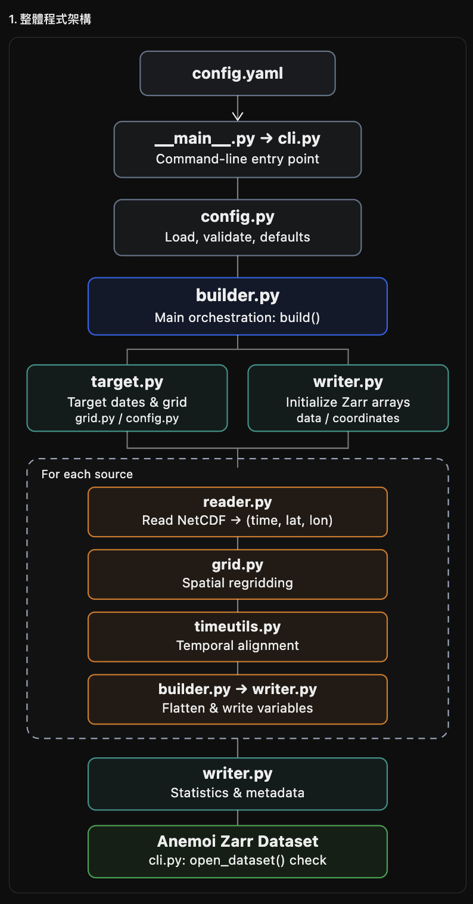
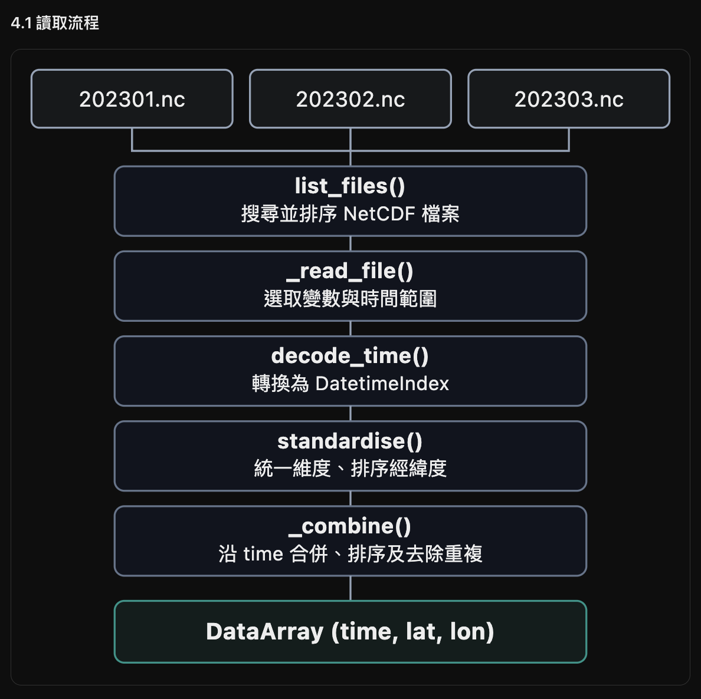
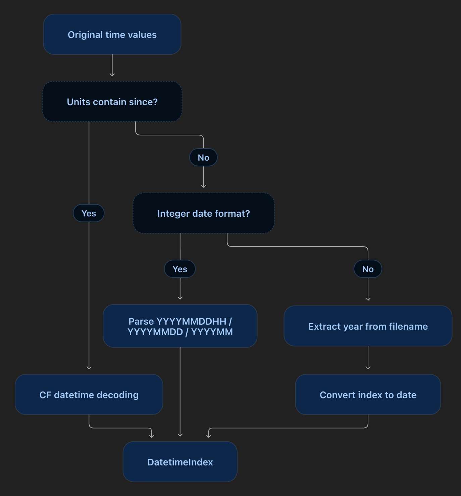

# anemoi_zarr

Create an [anemoi-datasets](https://anemoi.readthedocs.io/projects/datasets/) compatible
Zarr store from different NetCDF source datasets (e.g. ERA5 pressure levels, ERA5-Land,
TCCIP gridded observations).

A YAML config lists the source folders, the variables (and pressure levels) to take from
each one, the time period, the output time step and the target grid. Every variable is
put on **one common lat/lon grid** and **one common time axis**, then written in the
anemoi layout together with per-variable statistics.



## Repository layout

```
anemoi_zarr/
├── config/
│   ├── default_local.yaml   # small test config, reads ../data/
│   └── default_BIG.yaml     # production config, reads /lfs/archive/...
├── data/                    # local sample NetCDF files (git-ignored)
├── env/anemoi.yml           # conda environment
├── graphics/                # overview.png, reader.png, timeutil.png
└── src/
    ├── build_anemoi_zarr.py # entry point
    └── nc2anemoi/           # implementation package
```

| Module | Responsibility |
|---|---|
| `cli.py`, `__main__.py` | Command-line interface, optional `anemoi.datasets.open_dataset` check |
| `config.py` | Load / validate YAML, defaults, variable + pressure-level expansion, period & frequency parsing |
| `builder.py` | Orchestration: build target, process every source, statistics, attributes |
| `target.py` | Output time axis and grid (`Target` dataclass) |
| `reader.py` | Find files, read variables, select pressure levels, concatenate along time |
| `timeutils.py` | Decode time axes (CF, `YYYYMMDD`, TCCIP `daily`) and align them to the output axis |
| `grid.py` | Target grid definition, longitude convention, regridding |
| `writer.py` | Zarr arrays, running statistics, anemoi attributes |

## Installation

```bash
conda env create -f env/anemoi.yml
conda activate anemoi
```

Minimal requirements if you prefer pip: `numpy pandas xarray netCDF4 scipy zarr<3 pyyaml`
(`anemoi-datasets` is optional and only used to verify the result).

## Usage

Run from `src/` — relative `path:` entries in the config (e.g. `../data/`) and the
output Zarr are resolved against the current working directory.

```bash
cd src
python build_anemoi_zarr.py ../config/default_local.yaml --overwrite
# or
python -m nc2anemoi ../config/default_local.yaml --overwrite
```

| Option | Description |
|---|---|
| `config` | YAML config file |
| `--overwrite` | Replace an existing output store |
| `--block N` | Time steps per write / statistics block (default `366`) |

The output is named automatically from the period, e.g. `anemoi_200101-200103.zarr`
(set `output:` in the config to override).

## Configuration

```yaml
# Time period (inclusive). YYYYMM or YYYYMMDD; "200103" as end = up to 2001-03-31.
period: ["200101", "200103"]

# Output time step; must be a fixed step (1D, 6h, 24h, ...).
frequency: 1D

grid:
  # Option A: use the grid of one source (index into `sources`)
  # reference: 0
  # Option B: explicit grid [start, stop, step], inclusive
  lat: [5, 40, 0.25]
  lon: [100, 140, 0.25]
  method: linear            # default regrid method: linear | nearest

sources:
  - path: /lfs/archive/Reanalysis/ERA5/PRS/day/
    pattern:                # string or list of glob patterns inside `path`
      - "[qtuvz]/200[1-3]/ERA5_*.nc"
    variables:              # mapping var -> pressure levels (hPa)
      z: [500]
      t: [850]
      u: [850]
      v: [850]
      q: [850]
    level_coord: level      # name of the pressure coordinate (default "level")
    time_method: mean

  - path: /lfs/archive/Reanalysis/ERA5-Land/soil/
    pattern: "ERA5-Land_*.nc"
    variables: [swvl1, swvl2, swvl3]   # plain list for surface fields

  - path: /lfs/archive/TCCIP_data/grid/day/0.05deg/tavg/v1/
    pattern: "tavg.*.nc"
    variables: [temp]
    rename: {temp: tavg}

# Optional metadata stored in the Zarr attributes
description: "Anemoi Zarr for HeatSense"
licence: "unknown"
attribution: "TCCIP, ECMWF"
```

### Top-level keys

| Key | Required | Default | Description |
|---|---|---|---|
| `period` | yes | – | `[start, end]`, inclusive, `YYYYMM` / `YYYYMMDD` / ISO |
| `sources` | yes | – | List of source definitions (below) |
| `frequency` | no | `1D` | Output time step |
| `grid` | no | `{reference: 0}` | `reference: <index>` or explicit `lat` / `lon` |
| `grid.method` | no | `linear` | Default regrid method for all sources |
| `output` | no | `anemoi_<start>-<end>.zarr` | Output path |
| `description`, `licence`, `attribution` | no | – | Copied into Zarr attributes |

### Source keys

| Key | Default | Description |
|---|---|---|
| `path` | – | Folder with NetCDF files |
| `pattern` | `"*.nc"` | Glob pattern or list of patterns (`**` = recursive) |
| `variables` | – | List of names, or mapping `name: [levels in hPa]` (`null` = no level) |
| `level_coord` | `level` | Pressure coordinate; units `hPa`/`mb` or `Pa` are supported |
| `rename` | `{}` | Output names, keyed by NetCDF name (`temp: tavg`) or expanded name (`t_850: t850`) |
| `time_method` | `auto` | `auto`, `exact`, `ffill`, `nearest`, `interpolate`, `mean` |
| `regrid_method` | `grid.method` | `linear` or `nearest` |

Variables with pressure levels are expanded to `<name>_<level>` (e.g. `z_500`, `t_850`).
Output variable names must be unique across all sources — use `rename` to resolve clashes.

## How it works

For each source, `builder.py` runs: **read → regrid → align time → write**, then computes
statistics and attributes once all sources are written.

### 1. Read (`reader.py`)



| Step | Function | What it does |
|---|---|---|
| 1 | `list_files()` | Find and sort the NetCDF files matching `path` + `pattern` (one or more globs) |
| 2 | `_read_file()` | Open each file, keep the requested variables, select pressure levels (`select_level()`), keep only time steps inside the period (plus a small buffer) |
| 3 | `decode_time()` | Convert the file's time axis to a `pandas.DatetimeIndex` (see below) |
| 4 | `standardise()` | Rename dims to `(time, lat, lon)`, drop singleton dims, sort lat/lon ascending |
| 5 | `_combine()` | Concatenate the per-file pieces along `time`, sort and drop duplicate dates |

The result is one `DataArray(time, lat, lon)` per output variable. Files are opened with
`decode_times=False`, but `_FillValue` / `missing_value` are still masked to NaN.

### 2. Decode time (`timeutils.py`)



`decode_time()` tries, in order:

1. **Units contain `since`** → CF datetime decoding, e.g. ERA5
   `hours since 1900-01-01` (non-standard calendars are converted from cftime).
2. **Integer date format** → values in a plausible range are parsed as
   `YYYYMMDDHH`, `YYYYMMDD` or `YYYYMM`.
3. **Otherwise** → the values are treated as a step index within a year
   (e.g. TCCIP `units = "daily"`, 1..365): the **year is extracted from the file name**
   (`tavg.2001.daily…nc` → 2001) and the 0- or 1-based index is converted to dates
   (days by default; `hour…` / `month…` units give hourly / monthly steps).

### 3. Regrid (`grid.py`)

Interpolate onto the target grid (`linear` / `nearest`); grids that already match are copied
unchanged; points outside a source domain become NaN. Longitudes are converted between
`[0, 360)` and `[-180, 180)` when needed.

### 4. Align time (`timeutils.py`)

`align_time()` puts each variable on the output dates. With `time_method: auto`:

- coarser source (e.g. monthly → daily): `ffill`, each step gets its period's value
- finer source (e.g. hourly → daily): `mean` over each output step
- same step: `exact` date matching

`nearest` and `interpolate` (linear in time) can be set explicitly per source.

### 5. Write (`writer.py`)

Variables are flattened to `(time, cell)` and written into `data`; then NaN-aware
statistics and the anemoi attributes are added and the metadata is consolidated.

## Output layout

| Array | Shape | Type |
|---|---|---|
| `data` | `(time, variable, ensemble=1, cell)` | float32, chunk = one date |
| `dates` | `(time,)` | datetime64[s] |
| `latitudes`, `longitudes` | `(cell,)` | float64, `cell = ilat * nlon + ilon` |
| `mean`, `stdev`, `minimum`, `maximum`, `sums`, `squares`, `count`, `has_nans` | `(variable,)` | NaN-aware statistics |

Attributes include `variables`, `name_to_index`, `variables_metadata` (source, units,
pressure level, methods used), `frequency`, `resolution`, `field_shape`, `flatten_grid`,
`start_date` / `end_date`, `allow_nans` and the full `recipe` (config).

Quick check:

```python
from anemoi.datasets import open_dataset
ds = open_dataset("anemoi_200101-200103.zarr")
print(ds.shape, ds.variables, ds.frequency, ds.field_shape)
```

## Notes

- Variables with an extra non-singleton dimension (other than the selected pressure level)
  raise an error — select a single level first.
- Regridding is point interpolation (`linear` / `nearest`), not conservative. When going
  from a fine to a coarse grid (e.g. TCCIP 0.05° → 0.25°) values are sampled, not
  area-averaged; pre-average the source if area means matter.
- NaNs (e.g. ocean points in ERA5-Land or TCCIP) are kept; `allow_nans` is set accordingly.
  Dates that are entirely NaN for a variable are logged as warnings.
